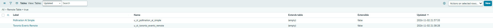
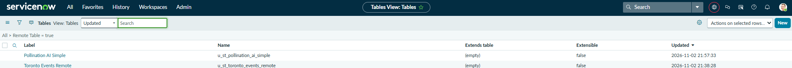
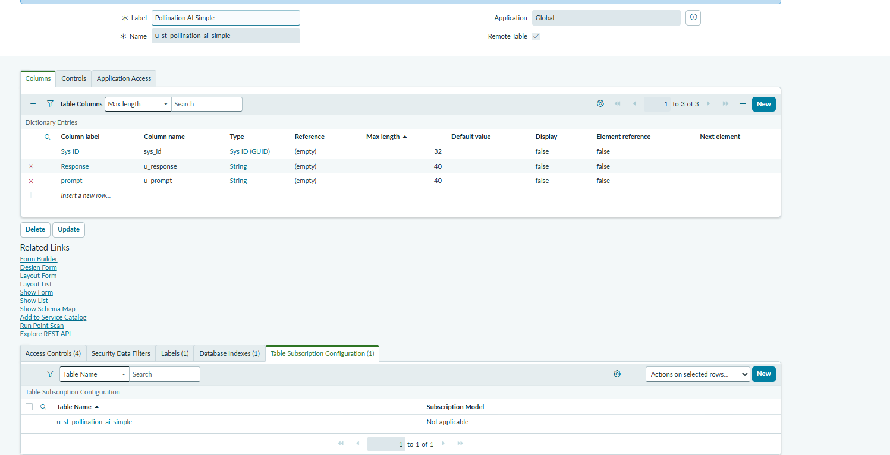
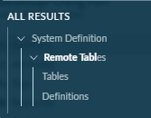
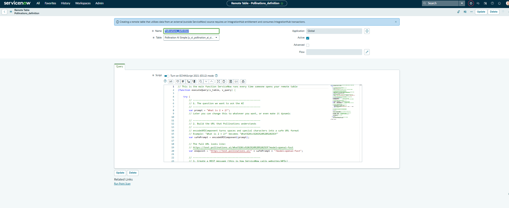
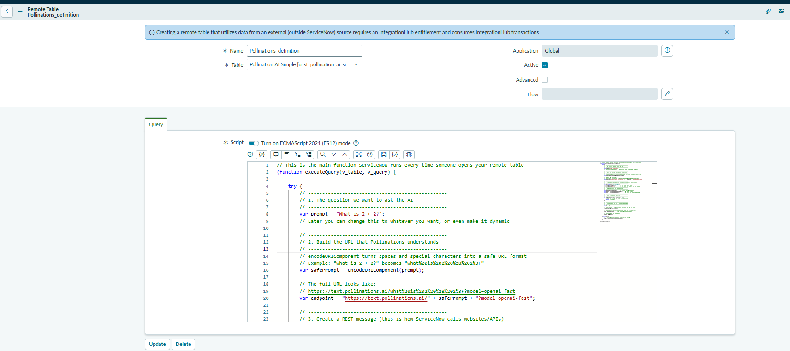
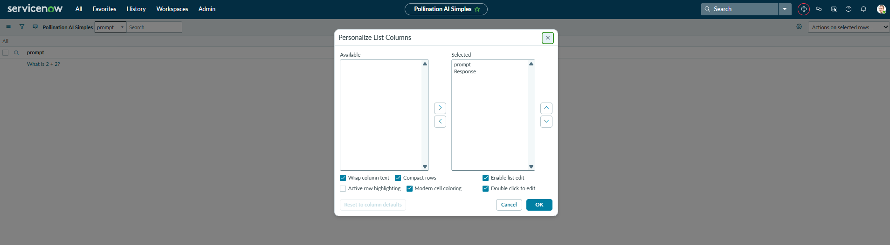
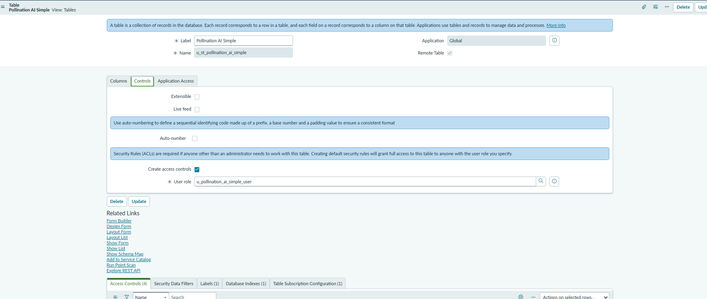
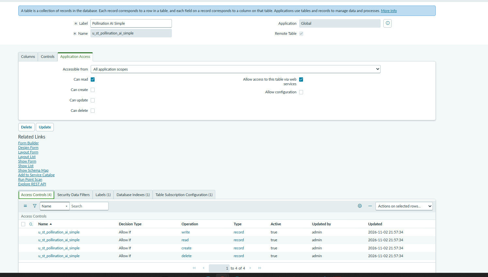
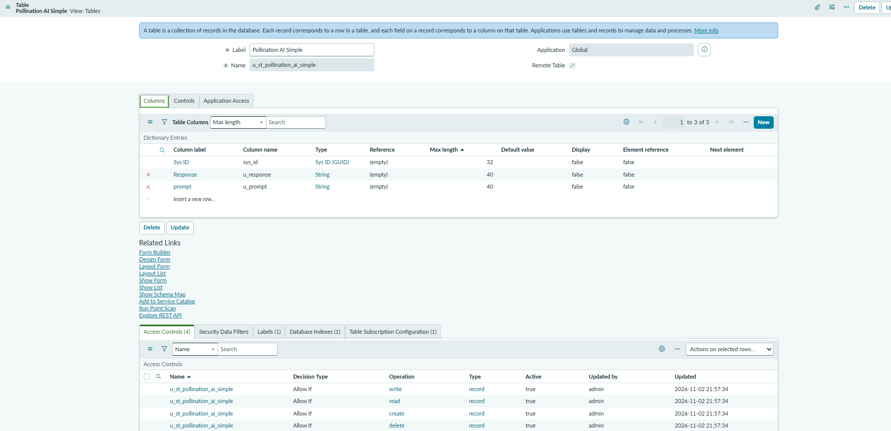

# ServiceNow Remote Table — Beginner Guide (Pollinations AI example)

A remote table lets you show live data from an outside source (like an AI API) inside ServiceNow without storing the rows in the database. The table definition lives in ServiceNow; the rows are built in memory every time someone opens the list.

This guide walks through a simple example that calls the free Pollinations AI endpoint.

## Table of Contents

- [Step-by-step: Create the Remote Table](#step-by-step-create-the-remote-table)
- [Step-by-step: Create the Query Script (Definition)](#step-by-step-create-the-query-script-definition)
  - [IntegrationHub entitlement note](#integrationhub-entitlement-note)
  - [What the Flow field does](#what-the-flow-field-does)
  - [Why `v_table` and `v_query` exist](#why-v_table-and-v_query-exist)
- [Why Sys ID is not visible in the list (and how to show it)](#why-sys-id-is-not-visible-in-the-list-and-how-to-show-it)
  - [How to make Sys ID visible on the list](#how-to-make-sys-id-visible-on-the-list)
  - [What `row.sys_id = gs.generateGUID();` actually does](#what-rowsys_id--gsgenerateguid-actually-does)
- [Deep dive: `v_table`, `v_query`, transforming data, cooldowns, and dynamic prompts](#deep-dive-v_table-v_query-transforming-data-cooldowns-and-dynamic-prompts)
- [Access Control — Who can see the remote table?](#access-control--who-can-see-the-remote-table)
- [Beyond this demo — things you can do next](#beyond-this-demo--things-you-can-do-next)
- [Remote Table out-of-box sample code (reference only)](#remote-table-out-of-box-sample-code-reference-only)

---

## Step-by-step: Create the Remote Table

After creation you will see both remote tables in the list:




**Navigation breadcrumbs:**  
Application Navigator → **System Definition** → **Remote Tables** → **Tables** → **New**

1. Click **New**.
2. Fill in:
   - **Label**: `Pollination AI Simple` (this is the friendly name users see)
   - Make sure the **Remote Table** checkbox is checked
   - ServiceNow will auto-generate the system **Name** (something like `u_st_pollination_ai_simple`)
3. Click **Submit**.
4. On the new table form, go to the **Columns** related list and add:
   - `u_prompt` (String, ~255) — the question you ask the AI
   - `u_response` (String, ~4000) — the answer the AI returns
   - Keep the existing `sys_id` (Sys ID / GUID)
5. (Optional but recommended) Create a module so it appears in the left-hand navigator:
   - On the table form, click **Create Module** or go to **System Definition → Modules → New**
   - Point it at your new table

**Remote Tables list** (your instance):
https://dev296154.service-now.com/now/nav/ui/classic/params/target/sys_db_object_list.do%3Fsysparm_userpref_module%3De9d76d1123403300edc0f4c947bf654e%26sysparm_view%3DTables%26sysparm_query%3Dscriptable_table%253Dtrue%255EEQ%26sysparm_clear_stack%3Dtrue



**Columns on the table:**


---

## Step-by-step: Create the Query Script (Definition)

**Navigation breadcrumbs:**  
Application Navigator → **System Definition** → **Remote Tables** → **Definitions** → **New**

The Remote Tables module contains two related lists:



- **Tables** — where you define the schema (columns)
- **Definitions** — where you write the Query script that populates the rows

Open **Definitions** and click **New** to create the script that calls Pollinations.

1. Click **New**.
2. Fill in:
   - **Name**: `Pollinations Query`
   - **Table**: select your remote table (`Pollination AI Simple`)
   - **Active**: checked
3. Scroll to the **Query** script field, delete the default template, and paste the code below.
4. **Save**.



The form shows the **Advanced** checkbox (left unchecked for this example) and the Query script that calls Pollinations.



### IntegrationHub entitlement note

The blue banner on the Definition form says:

> Creating a remote table that utilizes data from an external (outside ServiceNow) source requires an IntegrationHub entitlement and consumes IntegrationHub transactions.

This is official ServiceNow guidance. Using a remote table against an outside API (Pollinations, etc.) is treated as an Integration Hub use case.

- **Lab / PDI**: You can usually activate and use it for learning without a paid production subscription.
- **Production**: You need a real Integration Hub entitlement. Each external call can count against your transaction limit.

### What the Flow field does

The **Flow** field (Washington DC and later) lets you populate the remote table with a Flow Designer flow instead of a script.

**Order of operations when the remote table is opened:**
1. ServiceNow checks whether the Definition is Active.
2. If a **Flow** is filled in → it runs that flow (and the Script field is hidden).
3. If no Flow is set → it runs the **Query Script**.
4. The flow or script calls `v_table.addRow(...)` (or the Flow Designer “Create Remote Table Record” action).
5. The rows appear in the list/form (and can be cached if you set a TTL).

In Flow Designer the trigger is **Remote Table Query**. Inside the flow you call your REST/spoke action, then use **Create Remote Table Record** to add each row.


### What the Advanced checkbox does

On the Definition form there is an **Advanced** checkbox.

- **Unchecked (default)** — you write a normal Query script in the Script field. This is what we used for the Pollinations example.
- **Checked** — ServiceNow expects a more advanced pattern (typically used when you want to implement the full remote table interface or call a Script Include). For most simple external API cases you can leave it unchecked.

In this demo we left **Advanced** unchecked and put the entire logic inside the Query script.


### Why `v_table` and `v_query` exist

- `v_table` — the object ServiceNow gives you so you can add rows.  
  `v_table.addRow(row)` is the only way to put a record into the remote table.
- `v_query` — represents the current request.  
  We mainly use `v_query.setLastErrorMessage(...)` so errors show up at the bottom of the list instead of failing silently.

```javascript
// This function runs every time someone opens the remote table list
(function executeQuery(v_table, v_query) {

    try {
        // 1. The question we want to ask the AI
        var prompt = "What is 2 + 2?";

        // 2. Make the prompt safe for a URL
        // encodeURIComponent turns spaces and special characters into a safe format
        // Example: "What is 2 + 2?" becomes "What%20is%202%20%2B%202%3F"
        var safePrompt = encodeURIComponent(prompt);

        // Full URL example:
        // https://text.pollinations.ai/What%20is%202%20%2B%202%3F?model=openai-fast
        var endpoint = "https://text.pollinations.ai/" + safePrompt + "?model=openai-fast";

        // 3. Create a REST message (ServiceNow’s tool for calling external websites)
        var rm = new sn_ws.RESTMessageV2();
        rm.setEndpoint(endpoint);
        rm.setHttpMethod("GET");   // GET = just ask for data, no body needed

        // 4. Send the request
        var response = rm.execute();
        var status   = response.getStatusCode();  // 200 = success
        var body     = response.getBody();        // the plain text answer

        // 5. Handle errors
        if (response.haveError() || status != 200) {
            v_query.setLastErrorMessage("Pollinations error " + status + ": " + body);
            return;
        }

        // 6. Build one row and add it
        var row = {};
        row.sys_id     = gs.generateGUID();  // unique ID so the form can open
        row.u_prompt   = prompt;
        row.u_response = body;

        v_table.addRow(row);

    } catch (ex) {
        v_query.setLastErrorMessage(ex.message);
    }

})(v_table, v_query);
```

**To test:** Open the list of your remote table from the navigator. The script runs automatically and you should see one row.

**Resulting table list** (cooldown ~1 minute because of Pollinations rate limit):
https://dev296154.service-now.com/now/nav/ui/classic/params/target/u_st_pollination_ai_simple_list.do

> **Note:** The free Pollinations endpoint is rate-limited (about 1 request every 45 seconds per IP). If you see a 402 error, just wait a minute and refresh.

---

## Why Sys ID is not visible in the list (and how to show it)

**Why this section exists**

When you open a list and click the gear icon (**Personalize List Columns**), `sys_id` is almost never in the Available columns. This is true for most tables in ServiceNow — not just remote tables. People often think the field is missing or that their script failed to set it. It is not missing. It is intentionally hidden from the normal personalize UI.

**Why ServiceNow hides it**

- `sys_id` is an internal primary key (a 32-character GUID).
- It is not meant for everyday business users. Showing it by default would clutter lists and encourage people to copy or edit it.
- The platform still uses it under the hood for forms, references, and uniqueness. Your remote table script must still set `row.sys_id` so the form can open and the row is unique.



The value exists on every row (your script sets `row.sys_id = gs.generateGUID()`). You just cannot add the column through the normal personalize dialog. That is why the steps below exist.

### How to make Sys ID visible on the list

**Navigation breadcrumbs:**  
Application Navigator → **System UI** → **Lists**

1. Find the list record for your table (`u_st_pollination_ai_simple`) and the view you use (usually “Default”).
2. Open that list record.
3. In the **List Elements** related list, click **New**.
4. Set:
   - **Element** = `sys_id`
   - **Position** = whatever order you want (e.g. 100 or 1)
5. Save.
6. Go to `cache.do` in the browser (or log out and back in) to clear the cache.
7. Re-open your remote table list.  
   Sys ID should now appear as a column. You can then personalize/reorder it if needed.

**Alternative (form view):**  
Right-click the form header → **Configure** → **Form Layout** → double-click in the empty space outside the slushbucket → `sys_id` appears → move it to the selected side.

### Is showing Sys ID on lists or forms a best practice?

**For general business users: No.**

- A `sys_id` is a 32-character hexadecimal string. It adds clutter and horizontal scrolling without giving readable context.
- ServiceNow hides it by design because it is a low-level primary key meant for the platform, integrations, and scripts — not for end users.
- Exposing it increases the chance of someone copying or editing it incorrectly.

**When it is acceptable**

- Admins, developers, and integrators who need it for troubleshooting, data migrations, bulk updates, or API work.
- Temporary troubleshooting on a personal list view (not a shared/public list).

**What to do instead**

- Leave `sys_id` off the default list and form for business users.
- If you need the value, grab it from the URL when you open a record, or use a background script / export.
- If you must show it for a specific technical audience, add it only on a dedicated list view (via System UI → Lists → List Elements) rather than the default view everyone sees.


### What `row.sys_id = gs.generateGUID();` actually does

```javascript
row.sys_id = gs.generateGUID();
```

`gs.generateGUID()` creates a new random 32-character unique ID (a GUID). You put that value into the `sys_id` field of the row object before you call `v_table.addRow(row)`.

**Is it temporary?**

- The row itself only lives in memory (it is not stored in the ServiceNow database).
- But the `sys_id` you assign is still required while that row exists in the current query result.
- If you open the form, filter, or reference that row, ServiceNow uses the `sys_id` you supplied to identify it for that request/session.
- Next time the list is loaded, the script runs again and generates a brand-new GUID (unless you deliberately reuse the same one).

**Why is it still needed on a remote table?**

ServiceNow requires every row (even remote/in-memory rows) to have a non-empty, unique `sys_id`.

Reasons:
1. **Forms and navigation** — When you click a row to open the form, ServiceNow looks up the record by `sys_id`. Without one, the form cannot open.
2. **Uniqueness** — The platform enforces that every row returned by the remote table must have a unique `sys_id`. If two rows share the same one (or have a blank one), you get warnings or errors.
3. **References and related lists** — If another table or a form references your remote table, it needs a stable `sys_id` to point at.
4. **Caching and query matching** — When caching is enabled, or when the user does a “get by sys_id”, ServiceNow uses the value you set.

Official behavior (from the out-of-box sample comments):
> `sys_id` must be non-empty and uniquely identify each row.  
> The above rule will be strictly enforced for editable tables, and generate warnings for read-only tables.

**Practical tip:** If your external data already has a stable unique ID (for example a primary key from MySQL or an external ticket number), you can use that instead of generating a random GUID:

```javascript
row.sys_id = externalRecord.id;   // reuse the external unique key
```

That way the same logical record keeps the same `sys_id` across refreshes, which makes forms, references, and caching more predictable.

**Bottom line:** Even though the data is not stored in ServiceNow’s database, you still must supply a unique `sys_id` so the platform can treat the in-memory row like a real record.

---

## Deep dive: `v_table`, `v_query`, transforming data, cooldowns, and dynamic prompts

### Why do you add rows with `v_table`?

A remote table has **no database rows**. Every time someone opens the list, your script must manually build the rows and hand them to ServiceNow.  
`v_table.addRow(row)` is what makes a record appear.

**Example — returning 3 different AI answers:**
```javascript
var questions = ["What is 2 + 2?", "Capital of France?", "Color of the sky?"];

for (var i = 0; i < questions.length; i++) {
    var row = {};
    row.sys_id     = gs.generateGUID();
    row.u_prompt   = questions[i];
    row.u_response = callAI(questions[i]);   // your REST call
    v_table.addRow(row);                     // this is what makes the row appear
}
```
Without `v_table.addRow()`, nothing shows up in the list.

### What is `v_query` for?

`v_query` is the **request object**. It tells you what the user is asking for and lets you talk back to the platform.

Common uses:
- `v_query.setLastErrorMessage("something broke")` — shows a red error banner at the bottom of the list
- `v_query.isGet()` / `v_query.getSysId()` — someone opened a single form (not the list)
- `v_query.getParameter("u_prompt")` — the user filtered or searched on a field
- `v_query.getEncodedQuery()` — the full filter the user applied

You almost always use it for error reporting and for reading what the user is looking for.

### Transforming data (currency example)

You do the transformation **before** you call `v_table.addRow()`.  
Neither object does the math for you — you do it in normal JavaScript, then put the clean value in the row.

**Example — turn `"4.433"` into `$4.43`:**
```javascript
var raw = "4.433";                          // came from the API as a string
var number = parseFloat(raw);               // 4.433
var rounded = Math.round(number * 100) / 100; // 4.43
var currency = "$" + rounded.toFixed(2);    // "$4.43"

var row = {};
row.sys_id = gs.generateGUID();
row.u_amount = currency;                    // put the transformed value in the row
v_table.addRow(row);
```
You can do this for every field you want cleaned, formatted, rounded, etc.

### Safeguard against spamming the API (cooldown)

You can store the last call time in a system property (or a tiny local table) and skip the API if it is still in cooldown.

**Simple version using a system property:**
```javascript
var lastCall = gs.getProperty("pollinations.last_call", "0");
var now = new Date().getTime();
var cooldownMs = 45 * 1000;                 // 45 seconds

if (now - parseInt(lastCall) < cooldownMs) {
    v_query.setLastErrorMessage("Still in cooldown — wait " + 
        Math.ceil((cooldownMs - (now - parseInt(lastCall))) / 1000) + " seconds");
    return;
}

// ... do the API call ...

// after a successful call:
gs.setProperty("pollinations.last_call", now.toString());
```
This stops the script from hitting Pollinations again until the cooldown is over.

### Let the user supply their own prompt

Use `v_query` to read what the user typed in the list filter or a search field.

**Example — user types a prompt in the filter:**
```javascript
// If the user filtered on the prompt field, use that value
var userPrompt = v_query.getParameter("u_prompt");

// Fallback if they didn’t filter
if (!userPrompt) {
    userPrompt = "What is 2 + 2?";
}

// then use userPrompt in the API call instead of the hard-coded string
```
The user can type something in the **prompt** column filter (or you can add a UI Action / catalog item that sets the filter) and the remote table will call the AI with their text.

---

## Access Control — Who can see the remote table?

Remote tables follow the same security rules as normal tables.

### What you configured

On the table form you set:

**Controls tab:**
- **Create access controls** checked
- **User role** = `u_pollination_ai_simple_user`



**Application Access tab:**
- Accessible from: All application scopes
- Can read: checked
- Can create / update / delete: unchecked
- Allow access to this table via web services: checked



**Access Controls related list** (auto-created):
- read, create, write, delete — all “Allow If” and Active



### What happens if a user **without** the `u_pollination_ai_simple_user` role tries to open the table

- They will **not** see the module in the navigator (if the module is restricted to that role).
- If they somehow navigate to the list URL directly, ServiceNow will show a **security constraint** / access denied message.
- They will not see any rows, and the query script will not even run for them.

### How to control it

**Navigation breadcrumbs:**  
Application Navigator → **System Definition** → **Remote Tables** → **Tables** → open your table → **Application Access** or **Controls** tab  
or  
**System Security** → **Access Control (ACL)** → search for your table name

- On the table form under **Application Access**, you can restrict which applications/roles can access it.
- Under **Controls**, checking “Create access controls” and naming a role generates the default ACLs for that role.
- For finer control, edit the ACLs so only users with `u_pollination_ai_simple_user` can read the table.
- Modules can also have a **Roles** field so only users with that role see the link in the navigator.

**Result:** Only users who have the `u_pollination_ai_simple_user` role (or admin) can open the list and see the AI responses.

---


## Next Remote Table build idea — Events via PHP + MySQL

You can point a second remote table at a simple PHP endpoint that queries a MySQL database of events. No real credentials are shown below — use placeholders.

### High-level idea

- Your webpage (or a small PHP script) exposes an endpoint such as:
  ```
  https://your-server.example.com/events.php?city=Toronto
  ```
- The PHP script connects to MySQL, runs a query, and returns JSON.
- The remote table Query script calls that endpoint with `sn_ws.RESTMessageV2` and turns each JSON row into a remote table row.

### Placeholder PHP endpoint (example)

```php
<?php
// events.php — placeholder only, do not use real credentials here
header('Content-Type: application/json');

$host = 'localhost';          // placeholder
$db   = 'events_db';          // placeholder
$user = 'readonly_user';      // placeholder
$pass = 'your_password_here'; // placeholder

$mysqli = new mysqli($host, $user, $pass, $db);
if ($mysqli->connect_error) {
    http_response_code(500);
    echo json_encode(['error' => 'DB connection failed']);
    exit;
}

$city = $_GET['city'] ?? 'Toronto';
$stmt = $mysqli->prepare('SELECT id, title, start_date, location FROM events WHERE city = ? LIMIT 50');
$stmt->bind_param('s', $city);
$stmt->execute();
$result = $stmt->get_result();

$rows = [];
while ($row = $result->fetch_assoc()) {
    $rows[] = $row;
}
echo json_encode($rows);
?>
```

### Setup steps for the remote table

1. **Create the remote table**  
   System Definition → Remote Tables → Tables → New  
   Label: `Toronto Events Remote`  
   Name will become something like `u_st_toronto_events_remote`.

2. **Add columns**  
   On the table form, Columns related list → New (or use the dictionary):
   - `u_event_id` (String)
   - `u_title` (String)
   - `u_start_date` (Date/Time or String)
   - `u_location` (String)

3. **Create the Definition**  
   System Definition → Remote Tables → Definitions → New  
   Point it at the table above and paste a Query script that:
   - Builds the PHP URL
   - Calls it with `sn_ws.RESTMessageV2`
   - Parses the JSON
   - Calls `v_table.addRow(row)` for each event

4. **Access controls**  
   Use the Controls tab to create a role (or reuse an existing one) so only the right users can open the list.

### Shortcut — do you have to create columns one by one?

**Yes, for a remote table you still create the columns on that table.**

- Even if you already have a normal (non-remote) table with the same fields, a remote table does not automatically inherit them.
- There is no “copy columns from another table” button on a remote table.
- Fastest options:
  - Add them manually in the Columns related list (usually only a handful).
  - Or use a background script / update set to insert the `sys_dictionary` records if you have many columns.
- You can look at the existing non-remote table’s dictionary entries and mirror the Column label / Column name / Type, but you still have to define them on the remote table itself.

Once the columns exist, the Query script just populates them from the JSON returned by the PHP endpoint.


## Beyond this demo — things you can do next

- Change the hard-coded `prompt` to read from a system property, a query parameter, or user input.
- Call the OpenAI-compatible endpoint (`https://text.pollinations.ai/openai`) so you get JSON + reasoning.
- Add a free API key from [enter.pollinations.ai](https://enter.pollinations.ai) to remove the rate limit.
- Cache the results (set a TTL on the Definition) so it doesn’t call the AI on every page load.
- Make the table editable and handle insert/update/delete scripts if you want to write back to the external system.
- Use the same pattern to pull from your own MySQL table (expose it as a REST API first).

---

<details>
<summary><strong>IGNORE BELOW — future updates / extra screenshots</strong></summary>

Quick Demo based on 
u_location	u_event_id	u_last_updated	u_event_date	u_title	sys_created_on	sys_created_by	sys_tags	sys_updated_on	sys_updated_by	sys_mod_count	sys_id


Table config: Columns


Controls


Application Access


Related Lists

Related Lists-Labels:


</details>

---

# Remote Table out-of-box sample code (reference only)

```javascript
(function executeQuery(v_table, v_query) {
     // Parameters:
     //      v_table - object to record response:
     //          v_table.addRow({ ... })                - adds a row to the result set.
     //              keys are the column names of the table definition.
     //              sys_id must be non-empty and uniquely identify each row.
     //                  the above rule will be strictly enforced for editable tables, and generate warnings for read-only tables.
     //                  sys_id will be supplied to the Update, and Delete scripts to specify the row's identity.
 
     //      v_query - the query definition:
     //          v_query.getEncodedQuery()              - encoded querystring
     //          v_query.getCondition(field)            - encoded querystring for the given field (includes field name, operator, and value)
     //          v_query.getParameter(field)            - parameter for the given field (only includes value for equality conditions)
     //          v_query.isGet()                        - whether the query is a single get by sys_id
     //          v_query.getSysId()                     - parameter for sys_id field
     //          v_query.isTextSearch()                 - whether the query contains a text query parameter
     //          v_query.getTextSearch()                - text search query parameter (internal field name 123TEXTQUERY321)
     //          v_query.getFirstRowWanted()            - the first row to include, don't use with caching
     //          v_query.getLastRowWanted()             - the last row to include, don't use with caching
     //          v_query.setLastErrorMessage(message)   - the message is visible from GlideRecord.getLastErrorMessage()
 
     // Sample code:
     //  try {
     //      retrieve-rows-from-external-system;
     //      if (there-was-an-error) {
     //          var message = ...;
     //          v_query.setLastErrorMessage(message);
     //          return;
     //      }
     //
     //      for (var row in rows) {
     //          v_table.addRow(row);
     //      }
     //  } catch (ex) {
     //      var message = ex.getMessage();
     //      v_query.setLastErrorMessage(message);
     //  }
 
  })(v_table, v_query);
```
